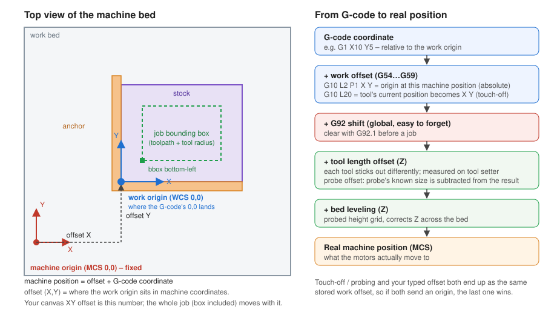

# CNC coordinates, offsets and probing — from scratch

A CNC keeps several coordinate systems. Each one is the previous one plus an offset.

## 1. Machine coordinates (MCS)
- The machine's own fixed frame, zero at the home switches. It never changes.
- `G53` moves in this frame.
- The controller's canvas is drawn in this frame (X and Y; see `MachineLayout`): home (0, 0) is the bed's top-right corner, the bed runs to (-200, -200), and the pills over the canvas show real machine coordinates.
  - The work bed is fixed. The stock, the anchor and the 0, 0, 0 axes arrows (top of the stock) sit at the active anchor's inside corner; the toolpath, bounding box and tool sit at the work origin = anchor + G-code offset.
  - Z is not mapped: it stays relative to the work origin (0 at the top of the stock), because the machine's Z offset depends on how the job is touched off.
  - The live tool is drawn at the machine's own X/Y, so if the stored offset differs from anchor + G-code offset, the tool visibly leaves the stock.

## 2. Work coordinates (WCS: G54, G55, …)
- The frame the G-code is written in. It is stored as an offset: `work = machine − offset`.
- The G-code says "cut at X10"; the machine adds the stored offset to get the real position. The same program runs anywhere on the bed by changing only that offset.
- Two ways to set it:
  - `G10 L2 P1 X.. Y..` — "the origin is at this machine position". **Absolute**, independent of where the tool is.
  - `G10 L20 P1 X0` — "make the tool's current position read X0". **Relative** to the tool. This is touch-off (the Zero buttons in `PanelCoordinate`).
- The canvas `xyOffset` is the typed version of this number: where the job's origin sits on the bed.

## 3. Temporary shift (G92)
A global shift stacked on top of the WCS, easy to forget. Clear it with `G92.1`. A stale one silently moves the whole job.

## 4. Z has extra offsets
- **Tool length offset:** each tool sticks out a different amount. The machine measures the tool tip so changing tools does not change the cut depth.
- **Probe offset:** a probe or tool setter has a known size/height. The machine subtracts it so the stored result is the true surface or edge.
- **Bed leveling:** a grid of probed heights that corrects Z across the bed, applied on top of everything else.

## Order of application
G-code coordinate → + WCS offset (G54) → + G92 shift (if any) → + tool length → + leveling → real machine position.

## How this relates to the app
- Touch-off (Zero buttons) and the typed canvas offset both end up as the same stored work offset in the machine. If both send an origin, the last one wins.
- `L20` depends on where the tool is when sent; `L2` does not. Running a job with a typed offset should use the absolute `G10 L2 P1`.
- Industry practice: do not rewrite the G-code. Post it once against a work origin and move the origin on the machine.
- Makera Carvera supports `G10 L2 P1`, `G54`, `G92`/`G92.1`, `G53`, `G28` (clearance position) — see https://wiki.makera.com/en/supported-codes. Whether a `G10 L2` offset survives a power cycle is not documented there; test it.
- Suggested pre-job sequence: `G92.1`, `G54`, `G10 L2 P1 X<x> Y<y>`.
- Prepended lines shift the machine's line numbers; `tableIndex(forMachineLine:)` must subtract them.
- Still to confirm: what `SL.Session.jobOriginCommands` and `zeroCommand` (in StratumLink) actually emit.
